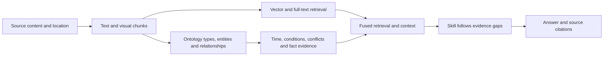
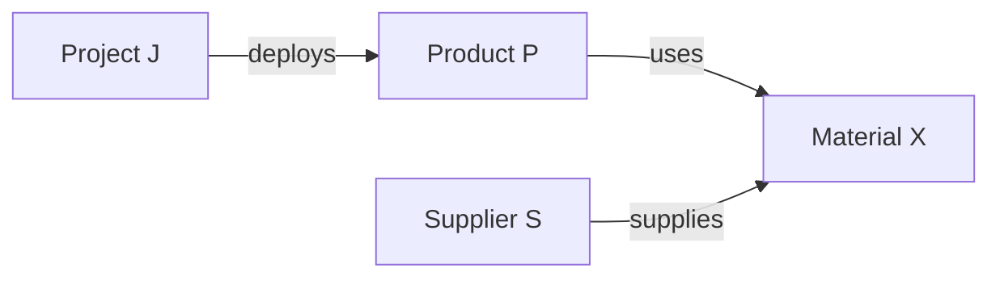

# Carrel 0.4.0 Knowledge Base Evaluation: Methods and Full Results

English | [中文](capability-evaluations-0.4.0.zh-CN.md)

Carrel is a self-hosted knowledge base for AI agents. It combines vector, full-text, and visual retrieval, using an ontology and knowledge graphs to connect entities, relationships, and facts across documents. The retrieval Skill, a retrieval tool for agents, can follow evidence gaps with additional queries, fetch surrounding context, and check sources.

This evaluation follows the full path from source files to evidence chunks, relationships and facts, and answers. It examines source location, related-evidence retrieval, temporal and conflict representation, ontology evolution, and graph rebuild behavior. Conventional retrieval metrics and these capabilities are reported separately.

## Main results

The evaluation covers 5 actual knowledge bases and 3,587 files. Source retrieval uses 275 valid questions. The answer experiment uses 55 questions selected from the real-document set and 20 synthetic questions. A separate set of 100 synthetic questions examines temporal, conflict, ontology, and related capabilities.

| Dimension | Main result | Interpretation |
|---|---|---|
| Source location | Evidence Hit@5 **92.36%**, MRR@10 **0.7979**; target-document Hit@5 **98.91%** | Measures location of answer-bearing chunks and their source documents separately |
| Required evidence coverage | Context evidence coverage **92.13%** | The share of required evidence retrieved per question, including adjacent and expanded chunks |
| Related evidence from the graph | Context evidence coverage on 38 cross-document questions rose from **64.21% to 68.73%** | The graph supplied some additional supporting evidence; overall Hit@5 and MRR did not improve alongside it |
| Targeted Skill follow-up | Required-point completeness on 25 real cross-document questions rose from **60% to 76%** | Follow-up queries helped answers cover points missing from the initial retrieval |
| Time and conflict representation | All 30 fact queries by source and cutoff date filtered correctly; all 10 predefined numerical conflicts retained both claims and conflict indicators | Source claims can be organized by time and compared side by side; ordinary search still has temporal-handling issues, and some coexisting values are incorrectly flagged as conflicts |
| Ontology topic evolution | Predefined entity coverage for both old and new topics was **100%** across four synthetic stages; type counts were **10 → 15 → 16 → 16** | Types for new topics entered the schema while evidence for existing topics remained available |
| Graph rebuilding | Rebuilding from cached extraction produced identical entity, relationship, and fact sets; Hit@5 was **90%** on 30 fixed questions across six versions | Cached rebuilds were identical and retrieval on the fixed set was similar; fresh extraction produced substantial changes in relationships and qualifiers |
| Image location | Full dual-reranking document Hit@5 was **9/16**, versus **14/16** with text-only reranking | Visual reranking reduced performance on this page-image location task |

## The evidence path from source to answer

A question may need a single source passage, a chart, connections between multiple documents, or the dates and conditions attached to a fact. These forms of evidence enter the answer through the following path:

## Evaluation setup

| Item | Setting |
|---|---|
| Code revision | `f466d91`, preparation for the 0.4.0 release |
| Actual knowledge bases | 5 bases, 3,587 files, 100,119 active chunks |
| Source-grounded question set | Built from 107 source files; 275 valid questions and 454 required evidence groups |
| Question types | Facts, parameters, conditions, procedures, negation, tables, images, code, cross-document comparison and summary, time, conflicts, and ontology concepts |
| Source specification | 164 questions explicitly name source documents; 111 use open formulations |
| Boundary scenarios | 100 synthetic questions and 131 generic synthetic documents |
| Graph assets | 174,458 entities, 348,161 relationships, and 225,802 fact records |
| Graph evidence sample | 450 items: 150 entities, 150 relationships, and 150 facts |
| Rebuild experiments | Two real knowledge bases; rebuild from cached extraction, two fresh extractions with fixed labels, and two rebuilds after extracting labels again |
| Text embedding | Qwen3-Embedding-0.6B, 1,024 dimensions |
| Text reranker | Qwen3-Reranker-4B |
| Visual embedding / reranker | Qwen3-VL-Embedding-2B / Qwen3-VL-Reranker-2B, 2,048-dimensional visual vectors |
| Graph extraction | DeepSeek Flash |
| Visual understanding and independent model review | Qwen3.8 Flash Next; thinking disabled for review calls |
| Answer model | Claude Haiku 5.5, with usage and timing recorded by an evaluation program built on the Codex SDK |
| Serving environment | DGX Spark; fixed models and retrieval parameters; visual-reranker image preprocessing cache set to 0 GiB |

Embedding and reranking models run in BF16 using NVIDIA's vLLM `26.10-py3` image. Retrieval, embedding, and reranking services run on one DGX Spark; the visual-understanding model runs on two other nodes. The answer stage calls Claude Haiku 5.5 through the Codex SDK with `xhigh` reasoning effort, processing two questions concurrently.

Retrieval uses 50 text-vector candidates, 30 full-text candidates, and 20 visual candidates. When enabled, the graph adds up to 60 candidates. Text reranking processes 64 candidates, and visual reranking processes 8. The API returns the top 10 hits with a 6,000-token source-context budget. Source formats include PDF, Markdown, Office documents, spreadsheets, images, and source code.

DeepSeek drafted the source-grounded questions from file contents. Qwen checked them independently, and an AI review agent reviewed wording and sources before mapping them to evidence chunks in the current index. Reference answers use source evidence. Questions and evidence annotations were frozen before formal retrieval scoring. Two questions were excluded because of a source misreading and duplicate intent; their original records were retained. The set was divided by document into 57 pilot questions and 218 held-out questions, with no source-file overlap. The production retrieval algorithm was not tuned to these evaluation results.

The 100 synthetic questions comprise 10 variations in names, values, and dates for each of 10 scenario types. They cover historical records, cutoff dates, conflicts, equivalent units, multi-hop relationships, direction, conditions and negation, planned status, same-name roles, and missing evidence. All run through the actual parsing, graph-building, and retrieval pipelines.

The answer experiment has three conditions: one retrieval call, targeted follow-up with the current retrieval Skill, and direct access to source evidence. Answers were randomly reordered for blind evaluation against the same source material, checking required facts, qualifiers, citations, latency, and token usage. The primary metric is required-point completeness: an answer must correctly present all predefined required points without a critical error affecting its conclusion. Open questions may admit other source-supported interpretations, so missing points and factual errors are recorded separately. The supplied-evidence group is also retained as generated, with missing excerpt context investigated separately.

The AI review agent checked all real cross-document questions, all synthetic questions, comparison questions sampled using a fixed hash rule, and failed items. Full answers were checked point by point against source support. Corrections addressed review-model errors such as treating a related concept as a complete required point, conflating adjacent metrics, or rejecting an additional citation merely because it was absent from the reference excerpt. Correction records use anonymous answer labels; questions, reference evidence, and generated answers remain unchanged.

Paired confidence intervals resample at the question level, keeping both conditions for each question together. They use 4,000 bootstrap samples and the 2.5th and 97.5th percentiles of the difference distribution.

## Retrieval and answers

All 275 valid questions use the actual HTTP retrieval API under three conditions: full retrieval, graph disabled, and text-only reranking. All three use the same sources, indexes, models, and `top_k=10`, with call order randomized for each question. All 825 valid-question requests returned HTTP 200. Another 6 requests for the two previously excluded questions also returned HTTP 200 and are excluded from scoring.

| Condition | Vector, full-text and visual retrieval | Graph | Text reranking | Visual reranking |
|---|---|---|---|---|
| Full retrieval | Enabled | Enabled | Enabled | Enabled |
| Graph disabled | Enabled | Disabled | Enabled | Enabled |
| Text-only reranking | Enabled | Enabled | Enabled | Disabled |

| Metric | Full retrieval | Graph disabled | Text-only reranking |
|---|---:|---:|---:|
| Evidence Hit@5 | 92.36% | 93.45% | 92.36% |
| Evidence MRR@10 | 0.7979 | 0.8129 | 0.8182 |
| Evidence-chunk nDCG@10 | 0.8041 | 0.8129 | 0.8131 |
| Required evidence-group Recall@10, averaged by question | 90.01% | 89.66% | 89.36% |
| Complete evidence in the top 10 hits | 85.09% | 85.82% | 84.73% |
| Evidence coverage including adjacent and expanded chunks | 92.13% | 91.42% | 92.24% |
| Target-document Hit@5 | 98.91% | 97.45% | 99.27% |

Evidence Hit@5 counts a hit when at least one annotated evidence chunk appears in the top five. Target-document Hit@5 requires at least one target file to be returned. MRR@10 takes the reciprocal rank of the first annotated evidence chunk, assigning zero when none appears in the top ten. nDCG treats annotated chunks as relevant and measures their positions in the top ten.

A required evidence group may be supported by one chunk or require several chunks together. Evidence-group Recall requires retrieval of a complete acceptable combination of chunks. Complete evidence in the top ten requires all evidence groups for a question. Context evidence coverage applies the same rule to a broader scope that includes adjacent and expanded chunks returned by the API. Coverage in the table is averaged by question; full retrieval's Recall@10 calculated directly over all 454 groups is 86.12%.

Full-retrieval results by knowledge base:

| Knowledge base | Questions | Hit@5 | MRR@10 | Context evidence coverage |
|---|---:|---:|---:|---:|
| Base A | 54 | 96.30% | 0.8205 | 97.84% |
| Base B | 57 | 91.23% | 0.8377 | 89.01% |
| Base C | 56 | 87.50% | 0.7958 | 91.96% |
| Base D | 49 | 89.80% | 0.7337 | 88.78% |
| Base E | 59 | 96.61% | 0.7938 | 92.88% |

Questions are also divided by how many source files they actually require:

| Source scope | Questions | Full: context evidence coverage | Graph disabled: context evidence coverage | Full: complete evidence in top 10 | Graph disabled: complete evidence in top 10 |
|---|---:|---:|---:|---:|---:|
| Single document | 237 | 95.89% | 95.78% | 93.67% | 93.67% |
| Cross-document | 38 | 68.73% | 64.21% | 31.58% | 36.84% |

The graph increases context evidence coverage for cross-document questions by 4.52 percentage points, while the share retrieving all required evidence directly in the top ten declines. These metrics measure breadth of related evidence and completeness within a limited ranking, respectively. Subsequent Skill follow-up is measured separately.

On the 218 held-out questions alone, full retrieval achieves Hit@5 of 94.04%, MRR@10 of 0.8052, and context evidence coverage of 93.06%. The main table includes all 275 valid questions.

Overall Hit@5 and MRR do not improve when the graph is enabled. Full retrieval's Hit@5 difference relative to graph-disabled retrieval is −1.09 percentage points, with a paired question-bootstrap 95% interval of −2.91 to +0.36 points. Context evidence coverage increases by 0.72 points, with an interval of −0.78 to +2.20. The additional related evidence is concentrated in some questions that require multiple pieces of evidence.

Dual and text-only reranking have the same overall Hit@5. The MRR difference is −0.0203, with a paired bootstrap 95% interval of −0.0364 to −0.0054. Direct evidence ranks more favorably with text-only reranking on this question set. Questions about source tables and images, and queries using an image as input, are evaluated separately.

### Page-image location

Direct image queries use 16 source-page images, each asking to locate the corresponding document and source position. All 32 requests succeeded and actually used the image-query path.

| Image-location metric | Full dual reranking | Text-only reranking, with visual retrieval retained |
|---|---:|---:|
| Corresponding-document Hit@5 | 9/16 (56.25%) | 14/16 (87.50%) |
| Corresponding-document MRR@10 | 0.4792 | 0.7433 |
| Corresponding-page Hit@5 | 4/16 (25.00%) | 8/16 (50.00%) |

Adding visual reranking reduced document and page-location performance on this task.

### Comparison with the published 0.3.0 report

| Evaluation | Location questions | Hit@5 | MRR | Rank cutoff | Text reranker |
|---|---:|---:|---:|---:|---|
| Published 0.3.0 report: full pipeline | 78 | 88.46% | 0.7327 | 12 | Qwen3-Reranker-0.6B |
| This 0.4.0 evaluation: full retrieval | 275 | 92.36% | 0.7979 | 10 | Qwen3-Reranker-4B |
| 0.4.0 supplementary replay: original 0.3.0 questions | 78 | 94.87% | 0.8251 | 12 | Qwen3-Reranker-0.6B |

A supplementary replay uses the 78 location questions from the published 0.3.0 report. **Both runs on these questions use Qwen3-Reranker-0.6B for text reranking**, with graph retrieval and dual reranking enabled and the top 12 hits returned. Hit@5 rises from 69/78 (88.46%) to 74/78 (94.87%), a gain of 6.41 percentage points; MRR@12 rises from 0.7327 to 0.8251. Source-file content hashes match. Target evidence was mapped to the newly parsed chunks, and the mapping was frozen before retrieval. These results measure the updated retrieval pipeline as a whole on the original questions.

The main 275-question evaluation uses the 4B reranker with a different document collection, question set, and difficulty mix, including cross-document and multi-evidence tasks. The replay above compares versions using the same questions and the same 0.6B reranker.

The 0.3.0 image subset contains 8 questions whose target evidence is an image. This evaluation's separate set of 16 page-location questions uses images directly as input. The input and evaluation target therefore differ.

Historical public results are available in the [0.3.0 retrieval evaluation](https://github.com/FengZhenfei/carrel/blob/f466d91eb04e67f90d0aa8b53eda41f0e406b4a1/docs/evaluations/retrieval-evaluations-0.3.0.md).

### Answer-level comparison

The 75 questions comprise 55 real-document questions and 20 synthetic questions. Each runs under all three conditions, producing 225 answers, all of which completed normally. Each single-retrieval run makes 1 search call. The Skill group makes 98 search, 32 context, 5 facts, 36 grep, 4 neighbors, and 8 docs calls in total. The supplied-source group uses no retrieval tools.

| Required-point completeness | Single retrieval | Skill follow-up | Source evidence supplied directly |
|---|---:|---:|---:|
| All 75 questions | 60/75 (80.00%) | 66/75 (88.00%) | 72/75 (96.00%) |
| 55 real-document questions | 44/55 (80.00%) | 48/55 (87.27%) | 52/55 (94.55%) |
| 25 real cross-document questions | 15/25 (60.00%) | 19/25 (76.00%) | 23/25 (92.00%) |
| 30 real single-document questions | 29/30 (96.67%) | 29/30 (96.67%) | 29/30 (96.67%) |
| 20 synthetic questions | 16/20 (80.00%) | 18/20 (90.00%) | 20/20 (100.00%) |

When measuring the proportion of correctly presented points per question, average coverage on real-document questions rises from 90.24% to 93.18%; on cross-document questions, it rises from 80.53% to 89.00%. Skill follow-up increases cross-document completeness by 16 percentage points over single retrieval, with a paired bootstrap 95% interval of +4 to +32 points. The increase across all real-document questions is 7.27 points, with an interval of 0 to +16.36.

The evaluation confirms critical errors in 4 single-retrieval answers and 2 Skill answers. In the real-document set, one answer denies a chapter's explicitly stated scope. Synthetic answers include declaring the newer price to be the current price, and converting units correctly while giving the opposite conclusion at the start. Answers missing predefined points are counted separately.

Item-by-item review of anonymous answers corrected 31 scoring records, after which results were reaggregated. The three incomplete answers in the supplied-source group involve excerpts missing chapter, stage, or table-header context.

### Anonymized real-document example: completing evidence across documents

Question: Document A says that complex projects with incomplete information are suited to pricing in stages. What does Document B say about dynamically adjusting execution plans and showing plans to users? How are these ideas related?

Excerpt from the single-retrieval answer:

> The planning chapter's body text was not retrieved, so I cannot explain how replanning works or confirm whether the plan is visible.

Excerpt after Skill follow-up:

> When a step fails or the situation changes, the agent replans from the current state … In most scenarios, showing the plan to the user and obtaining approval before execution is recommended.

The follow-up found a source passage missed by the initial retrieval and connected staged agreement on project scope with adjusting execution plans as circumstances change. The answer identified this connection as a synthesis and retained both sources.

These are translated excerpts from actual answers to the same question; document names and project references are anonymized.

## Source and graph evidence

Of 454 required evidence groups, 449 have complete support in the current index, including 8 that require multiple chunks together. The 5 groups without complete coverage involve styling, scripts, or image details in source files. They remain in the evidence-recall denominator.

A full structural graph check found no dangling relationship endpoints, unresolvable source units, or cross-base document references. In a stratified sample of 450 items, 408 are supported by evidence, 5 lack support or have an attribution issue, and 37 remain undecided within the sampled evidence package. A model checked the sample, and an AI review agent reviewed disputed items and some original pages.

| Sampled object | Supported | Confirmed issue | Undecided |
|---|---:|---:|---:|
| Entity description and type | 121 | 1 | 28 |
| Relationship | 142 | 4 | 4 |
| Fact | 145 | 0 | 5 |

Endpoint-type constraint flags and factual correctness measure different things. Of 59 flagged relationships in the sample, 58 are supported by evidence. Type constraints are more useful for checking schema coverage and annotation quality. Across the full graph, 33 entity types also contain separator residue that needs to be distinguished from legitimate code-related extension types.

Ontology quality is measured through specific, inspectable capabilities:

| Metric | Observation |
|---|---|
| Type-hierarchy integrity | All 5 bases have acyclic declared type hierarchies and no duplicate types after case normalization |
| Relationship direction and multi-hop chains | All 30 predefined directed relationships across 10 chains are retained, with source documents and units |
| Fact-qualifier fidelity | Version, region, negation, and planned status are checked separately in the next section |
| Entity identity distinction | Same-name entities with different roles are merged in all 10 scenarios; instance identity needs further distinction |
| Source traceability | The full structural check found no broken document or source-unit references |
| New topics and historical retention | Predefined entities from both old and new topics remain covered throughout the topic-evolution scenario |
| Applying governance feedback | Preview and consistency checks pass; applying feedback during rebuilding exposes an order-sensitive schema fingerprint issue |

## Time, conflicts, and qualifiers

Enterprise documents retain prices from different dates, rules for different regions, and capability descriptions for different versions. Synthetic scenarios in this section include historical prices, future notices, and different recorded values under the same conditions. They check what the graph preserves, what the API retrieves, and how answers interpret those records.

- All 30 fact-API calls specifying a source document and cutoff date exclude later records from both fact lists and sequence summaries.
- Direct fact queries using the plan name in the document body fail to resolve the subject in all 10 scenarios. The graph uses the name from the file title without creating an alias for the name in the body. Queries by source can retrieve these facts.
- Ordinary search can still return future source documents when given the same cutoff date. Fact-API filtering and retrieval-context time scope are not yet fully aligned.
- All 10 pairs of different measured values under the same conditions retain both facts and a conflict indicator. Another 3 scenarios with coexisting roles are incorrectly marked as conflicts: multiple roles and assignments within one organization are aggregated under a single attribute without distinguishing whether they are mutually exclusive.
- All 10 version-and-region scenarios, 10 explicit-negation scenarios, and 10 planned-status scenarios retain their qualifiers in the graph. The additional qualifier "not yet released" is retained in 8 scenarios.
- The 10 equivalent-unit scenarios can retrieve source text, and relationship descriptions retain the original values, but the structured fact API returns no corresponding records. Tracing finds that the two source passages contain 38 and 39 tokens, below the current 40-token threshold for narrative fact extraction; these passages never enter a fact-extraction call.
- Same-name entities with different roles are merged into a single node in all 10 scenarios, while role relationships remain. Entity identity distinction and relationship retention require separate checks.

### Synthetic example: historical prices for one plan

**Question:** List the price records for plan A in the same region and under the same support conditions, including future notices, and describe their dates.

The single-retrieval group's actual answer lists:

> 100 USD/month, applicable from 2024-02-01, recorded on 2024-01-01.\
> 120 USD/month, applicable from 2025-02-01, recorded on 2025-01-01.\
> 140 USD/month, applicable from 2027-02-01, recorded on 2027-01-01.

The answer also states that none of the three records specifies whether it supersedes the previous one. Publication dates, source-declared applicability dates, and historical values are retained. These dates belong to the synthetic scenario.

### Synthetic example: conflicting values under the same conditions

**Question:** Do two documents agree on a measurement for the same device, on the same day, on the same test bench, and under idle conditions?

The sources record 100 V and 103 V. The Skill follow-up group's actual answer identifies a difference of 3 V and retains both sources without selecting either as the correct value.

Both examples are drawn from saved answers and translated here. Questions are shortened, and plan and document names are simplified.

### Time filtering and business authority

Carrel stores source claims, provenance, dates, and applicability conditions. Historical records remain as evidence when new files arrive. Whether a record supersedes another depends on explicit supersession statements and business rules. Conflict indicators help an agent locate records for review; people and governance processes decide which record to adopt for business use.

After listing all prices or cutoff-date records, four answers describe the newer record as the current price or infer a supersession period without corresponding source support. Other answers explicitly label such statements as inferences and acknowledge the lack of supersession evidence. Answer-level temporal judgments and fact-API date filtering are evaluated separately.

## Related knowledge and multi-hop evidence

Synthetic documents distribute a business chain across three files: a project deploys a product, the product uses a material, and a supplier supplies that material. Questions ask for the supplier associated with the project, with supporting evidence.

Across 10 name-variation scenarios, the graph retains all three relationships with the correct direction. All 30 relationships have source documents and units. In one ordinary retrieval call, both full and graph-disabled retrieval find all three source documents in 8/10 scenarios. The relationship chain can be established in the graph; whether the caller retrieves all its evidence is measured separately.

Answer review also finds an API representation issue. The raw graph and neighborhood API have the correct directions, but relationship summaries in search responses omit the `directed` field. The Skill displays undirected connections and interprets the missing information as an "undirected graph." The underlying relationship direction and the direction information available to the caller differ in these records.

## Rebuild stability

Rebuild experiments distinguish two cases. A rebuild from cached extraction uses existing extraction results directly. A fresh extraction clears both the experiment's extraction-record cache and model-response cache, then extracts and builds again from the same source files. Jaccard is the size of the intersection divided by the size of the union. Relationship comparisons preserve direction and qualifiers; fact comparisons preserve values, dates, and conditions.

| Scenario | Base A: entity-set Jaccard | Base E: entity-set Jaccard | Base A: relationship-set Jaccard | Base E: relationship-set Jaccard |
|---|---:|---:|---:|---:|
| Cached rebuild vs. original | 100% | 100% | 100% | 100% |
| Two fresh extractions with fixed labels | 68.05% | 59.66% | 30.34% | 25.68% |
| Two rebuilds after extracting labels again | 44.02% | 50.10% | 11.15% | 18.92% |

Core and frequent entities are more stable than long-tail relationships during independent extraction. Fresh extraction with fixed labels retains 43 and 50 of the top 50 core entities in the two bases. Re-extracting labels retains 40 and 48, respectively.

Fact sets and their source-chunk sets are also compared:

| Scenario | Base A: fact-set Jaccard | Base E: fact-set Jaccard | Base A: fact-source-chunk-set Jaccard | Base E: fact-source-chunk-set Jaccard |
|---|---:|---:|---:|---:|
| Cached rebuild vs. original | 100% | 100% | 100% | 100% |
| Two fresh extractions with fixed labels | 32.15% | 46.42% | 99.01% | 100% |
| Two rebuilds after extracting labels again | 22.97% | 43.63% | 97.04% | 98.05% |

The source chunks covered by two extractions overlap heavily, while extracted fact expressions and qualifiers still change. Source coverage, set equality, and the semantic preservation examined below measure different levels of stability.

Of 160 semantic comparisons of relationships and facts, 113 preserve meaning, 24 change qualifiers, and 23 have no equivalent expression found. Of 80 relationships, 45 preserve meaning; of 80 facts, 68 do. The comparison expands to all candidates from the same source unit and reviews disputed cases. Changes may reflect either omissions or more precise re-expression. Retrieval stability is measured separately using the same question set.

Each of 30 fixed questions is submitted once to the actual retrieval API for each of six versions:

| Graph version | Hit@5 | MRR@10 | Context evidence coverage |
|---|---:|---:|---:|
| Original | 90.00% | 0.7048 | 87.78% |
| Rebuilt from cached extraction | 90.00% | 0.7048 | 87.78% |
| Fixed-label fresh extraction 1 | 90.00% | 0.7389 | 83.33% |
| Fixed-label fresh extraction 2 | 90.00% | 0.7214 | 86.67% |
| Label re-extraction 1 | 90.00% | 0.7214 | 86.67% |
| Label re-extraction 2 | 90.00% | 0.7056 | 86.67% |

Retrieval metrics after rebuilding from cached extraction match the original. Ordinary retrieval remains similar after independent extraction, while relationship-level semantics and qualifiers vary more.

## Ontology topic evolution and incremental consistency

Synthetic documents start with topic A dominant, gradually introduce topic B, increase B's share, and then bring A back. Historical documents remain throughout.

| Stage | A documents | B documents | A predefined entity coverage | B predefined entity coverage |
|---|---:|---:|---:|---:|
| A dominant | 12 | 0 | 48 / 48 | — |
| Both topics present | 12 | 12 | 48 / 48 | 72 / 72 |
| B grows | 12 | 36 | 48 / 48 | 216 / 216 |
| A returns | 36 | 36 | 144 / 144 | 216 / 216 |

The number of label types grows from 10 to 15 and 16, remaining at 16 when A returns. Types required by the new topic enter the schema while existing core types remain. Two types from the initial set drop out when both topics are present. With one fixed schema and documents added up to a total of 74, incremental and full results contain identical sets of 491 entities, 470 relationships, and 435 facts.

The 100% coverage across four stages refers to predefined named entities; the type set is inferred again as documents change. In the final fixed-schema comparison, the incremental path reuses 72 units and extracts 2 new units. The subsequent full path reuses the extraction results for all 74 units. This comparison measures assembly consistency with the same schema and extraction results. Variation from independent extraction is reported separately in the rebuild experiment.

## Asset lifecycle and governance feedback

Seven checks pass: repeated scanning, manual reparsing, source-file updates, renaming, deletion, restoration, and retrieval after updates. The current effective index has no duplicate versions.

Six governance-API checks pass: read-only preview, rejection of stale graph versions, rejection of stale revisions, knowledge-base identity validation, evidence requirements, and repeated submission. Applying governance feedback in a later rebuild produces one `stale_schema` error: semantically identical schemas are treated as different because list ordering changes. Revocation and backfill dependent on that application result are not counted as passed.

No cross-base source leakage is observed in 200 synthetic retrieval calls.

These governance checks cover Carrel's existing feedback interfaces. The Agent Loop, intended to clarify meaning through participation in business activity and conversations with people and to assist governance, is **not yet implemented and is in development**.

## Performance and operational observations

| Call type | Requests | Mean latency | P50 | P95 |
|---|---:|---:|---:|---:|
| Source question set: full retrieval | 275 | 2.03 s | 1.67 s | 4.11 s |
| Source question set: graph disabled | 275 | 1.61 s | 1.19 s | 3.43 s |
| Source question set: text-only reranking | 275 | 1.33 s | 0.79 s | 3.33 s |
| Separate repeated latency sample: 24 questions × 2 calls | 48 | 2.96 s | 2.80 s | 4.20 s |
| Page-image queries: full retrieval | 16 | 2.47 s | 1.96 s | 5.00 s |

Of the main retrieval experiment's 831 requests, 14 report partial-channel degradation while other channels still return results; scoring retains these actual results. Degradation comprises 8 visual-reranker HTTP errors, 2 visual-reranker timeouts, 3 full-text retrieval errors, and 1 vector-connection error. The separate 48-request latency sample and 32 image-comparison calls have no channel degradation. During the formal comparison, the image preprocessing cache is set to 0 GiB and the visual-reranker container has no further restarts. Targeted diagnosis traces HTTP 400 to an extremely narrow 797×2-pixel image whose preprocessing failure affects other candidates in the batch. Full-text errors arise from OpenSearch queries exceeding 1024 clauses. Diagnostic calls are saved separately and excluded from the metrics.

SDK answer-stage usage and latency for real-document questions include the full process of reading the Skill, retrieval, follow-up, and answer generation:

| Metric, 55 real-document questions | Single retrieval | Skill follow-up | Source evidence supplied directly |
|---|---:|---:|---:|
| Mean latency | 59.1 s | 71.0 s | 9.8 s |
| P50 | 57.3 s | 62.8 s | 9.0 s |
| P95 | 100.8 s | 140.3 s | 17.1 s |
| Mean input tokens | 86,885 | 119,577 | 10,730 |
| Of which: cached input tokens | 52,645 | 81,028 | 0 |
| Mean output tokens, including reasoning | 9,977 | 12,367 | 1,588 |
| Mean total tokens | 96,861 | 131,944 | 12,318 |

Token counts come from the SDK's cumulative usage events. Input already includes cached input, and output includes reasoning output; these components are not added twice. Multi-turn requests repeatedly carry context, so cumulative tokens and a single request's context length measure different things. Token totals include cache hits and do not directly represent charges at the standard token rate.

On the 25 real cross-document questions, mean latency rises from 75.1 to 99.7 seconds, and mean cumulative tokens from 114.8k to 181.1k. Single-document completeness remains the same; additional calls and gains are concentrated in more complex evidence gathering.

Two operational issues arise during evaluation. Large graph audits compete with production services for memory and trigger system OOM. An image preprocessing cache mismatch in visual reranking triggers an internal vLLM assertion and a restart. Subsequent offline graph analysis runs separately from retrieval services, and matched comparisons are rerun with the visual-reranker image preprocessing cache set to 0 GiB. Performance data from the fault period is retained separately.

The evaluation also completes 1,962 engineering regression tests, with 2 additional skipped tests and 132 subtests.

## Appendix: source-grounded question distribution

| Question type | Questions | Full-retrieval Hit@5 | Context evidence coverage |
|---|---:|---:|---:|
| Fact location | 66 | 93.94% | 93.94% |
| Parameters and numerical values | 36 | 91.67% | 97.22% |
| Procedures and operations | 37 | 94.59% | 97.30% |
| Applicability conditions | 42 | 97.62% | 98.81% |
| Negation | 11 | 90.91% | 100.00% |
| Tables | 18 | 94.44% | 94.44% |
| Image content | 6 | 83.33% | 83.33% |
| Code semantics | 3 | 100.00% | 100.00% |
| Cross-document comparison | 36 | 88.89% | 76.48% |
| Cross-document summary | 7 | 71.43% | 55.95% |
| Ontology concepts and responsibilities | 10 | 90.00% | 87.50% |
| Temporal records | 2 | 100.00% | 100.00% |
| Conflicting records | 1 | 0.00% | 66.67% |

Question types follow each question's primary intent. Cross-document status is annotated separately by the number of source files actually required, so a comparison question may compare several items within a single file. Low-frequency real question types, such as time and conflicts, are supplemented with synthetic scenarios.
