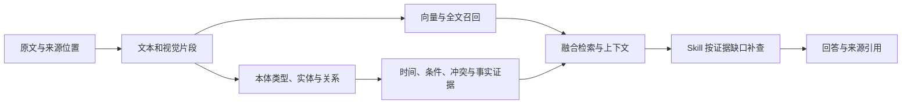
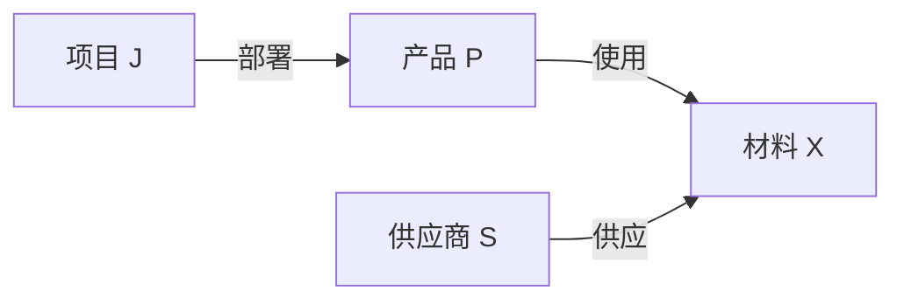

# Carrel 0.4.0 知识库能力测评：方法与完整结果

[English](capability-evaluations-0.4.0.md) | 中文

Carrel 是面向 AI Agent 的自托管知识库，结合向量、全文与视觉检索，并通过本体和知识图谱连接资料中的实体、关系与事实。检索 Skill（供代理使用的检索工具）可以根据证据缺口继续查询、补取上下文和核对来源。

本次测评沿着“原文件 → 证据片段 → 关系与事实 → 回答”的完整路径，检查 Carrel 的信息定位、关联召回、时序与冲突表达、本体演进和图谱重建表现。普通检索指标与这些能力分别报告。

## 主要结果

测评覆盖 5 个实际知识库、3,587 个文件。原文检索使用 275 道有效问题；回答实验使用其中选出的 55 道真实资料题及 20 道合成题；时序、冲突和本体等能力另通过 100 个合成问题检查。

| 观察维度 | 主要结果 | 对应含义 |
|---|---|---|
| 原文定位 | 证据 Hit@5 **92.36%**，MRR@10 **0.7979**；目标文档 Hit@5 **98.91%** | 分别衡量答案片段和所属文档的定位表现 |
| 必要证据覆盖 | 上下文证据覆盖 **92.13%** | 计入相邻与扩展片段后，逐题计算所需证据被取回的比例 |
| 图谱的关联召回 | 38 道跨文档题的上下文证据覆盖由 **64.21% → 68.73%** | 图谱补充了部分关联依据；整体 Hit@5、MRR 没有同步提高 |
| Skill 的定向补查 | 25 道真实跨文档题的关键要点完整率由 **60% → 76%** | 补查帮助回答覆盖一次检索尚未找到的要点 |
| 时间与冲突表达 | 30 次按来源、截止日查询事实均正确过滤；10 组预设数值冲突均保留双方及标记 | 原文声明可按时间组织、并列核对；普通检索的时间处理及多值冲突误报仍有问题 |
| 本体主题演进 | 合成场景的四个阶段中，新旧主题的预设实体覆盖均为 **100%**，类型数 **10 → 15 → 16 → 16** | 新主题进入模式，既有主题证据持续保留 |
| 图谱重建 | 复用缓存重建的实体、关系、事实集合完全一致；六个版本的 30 道固定问题 Hit@5 均为 **90%** | 复用缓存时结果一致；固定题集的检索表现接近；独立重新抽取时，关系及限定条件存在明显变化 |
| 图片定位 | 完整双重排文档 Hit@5 为 **9/16**，仅文本重排为 **14/16** | 本轮页面图定位任务中，视觉重排降低了表现 |

## 从原文到回答的证据路径

一个问题可能只需要一段原文，也可能依赖图表、多个文件之间的关联，以及事实的时间和适用条件。各类依据通过以下路径进入回答：

## 测评设置

| 项目 | 设置 |
|---|---|
| 代码版本 | `f466d91`，0.4.0 发布准备版本 |
| 实际知识库 | 5 个库，3,587 个文件，100,119 个活动切片 |
| 原文题集 | 从 107 份原文件制作；275 个有效问题，454 组必要证据 |
| 题型 | 事实、参数、条件、步骤、否定、表格、图像、代码、跨文档比较与总结、时序、冲突、本体概念 |
| 来源指定方式 | 164 题明确指定来源文档，111 题为开放表述 |
| 边界场景 | 100 个合成问题，131 份通用合成文档 |
| 图谱资产 | 174,458 个实体、348,161 条关系、225,802 条事实记录 |
| 图谱证据抽查 | 450 项：实体、关系、事实各 150 项 |
| 重建实验 | 两个真实库；复用缓存重建、两次固定标签重新抽取、两次重新抽取标签后建图 |
| 文本 Embedding | Qwen3-Embedding-0.6B，1,024 维 |
| 文本 Reranker | Qwen3-Reranker-4B |
| 视觉 Embedding / Reranker | Qwen3-VL-Embedding-2B / Qwen3-VL-Reranker-2B，视觉向量 2,048 维 |
| 图谱抽取 | DeepSeek Flash |
| 视觉理解与独立模型核对 | Qwen3.8 Flash Next；评审调用关闭思考 |
| 回答模型 | Claude Haiku 5.5，通过基于 Codex SDK 的测评程序记录用量与耗时 |
| 服务环境 | DGX Spark；固定模型与检索参数；视觉重排图片预处理缓存设为 0 GiB |

向量与重排模型以 BF16 运行，使用 NVIDIA vLLM `26.10-py3` 镜像。检索服务与向量、重排服务部署在同一台 DGX Spark；视觉理解模型部署在另两台节点。回答端通过 Codex SDK 调用 Claude Haiku 5.5，思考强度为 `xhigh`，并行执行两题。

检索设置为文本候选 50、全文候选 30、视觉候选 20，图谱参与时最多补充 60 个候选，文本重排处理 64 个候选，视觉重排处理 8 个候选。最终返回前 10 条命中，来源上下文预算为 6,000 token。资料格式覆盖 PDF、Markdown、Office 文档、表格、图片与源代码。

原文题集由 DeepSeek 根据文件内容拟定，经过 Qwen 独立核对和 AI 评审代理的表达、来源复核，再映射到当前索引中的证据片段。标准答案使用原文证据，题集与证据标注在正式检索评分前冻结。两个题目因原文误读、题意重复而剔除，原始记录保留。题集按文档划分为 57 道预备题和 218 道保留题，两组原文件没有交叉；本轮没有依据测评结果调整生产检索算法。

100 个合成问题由 10 类场景各生成 10 组名称、数值和时间变化，覆盖历史记录、截止日期、冲突、单位等价、多跳关系、方向、条件与否定、计划状态、同名角色和缺证问题。它们通过实际解析、建图和检索管线执行。

回答实验设置三个条件：一次检索、使用当前检索 Skill 定向补查、直接提供原文证据。回答随机换序后按同一份原文盲评，分别检查必要事实、限定条件、引用、耗时与 token 用量。主指标为“预设关键要点完整率”：冻结的全部必要要点正确呈现，且没有影响结论的关键错误。开放问题可以有其他有原文支持的总结角度，因此要点未覆盖与事实错误分别记录。给定证据组也保留原样，摘录缺少上下文的情况单独核查。

AI 评审代理复核全部真实跨文档题、全部合成题、按固定哈希规则抽样的对照题及未通过项。完整回答与原文支持关系逐项检查，修正了评审模型将相关概念当作完整要点、混用相邻指标、仅因额外引用不在标准证据摘录中就判为错误等评分问题。修正记录使用匿名回答标签，题目、标准证据与实际回答均不改动。

文中的配对置信区间以问题为重采样单位，同一题的两个条件始终一起比较，执行 4,000 次 bootstrap，取差值分布的 2.5% 和 97.5% 分位数。

## 检索与回答

275 个有效问题均走实际 HTTP 检索接口，每题分别测试完整检索、关闭图谱、仅使用文本重排。三组使用相同原文、索引、模型与 `top_k=10`，每题的调用顺序随机排列。825 次有效题请求均返回 HTTP 200。另有两个预先排除题对应的 6 次请求，同样返回 HTTP 200，不计入评分。

| 对照组 | 向量、全文与视觉召回 | 图谱参与 | 文本重排 | 视觉重排 |
|---|---|---|---|---|
| 完整检索 | 开启 | 开启 | 开启 | 开启 |
| 关闭图谱 | 开启 | 关闭 | 开启 | 开启 |
| 仅文本重排 | 开启 | 开启 | 开启 | 关闭 |

| 指标 | 完整检索 | 关闭图谱 | 仅文本重排 |
|---|---:|---:|---:|
| 证据 Hit@5 | 92.36% | 93.45% | 92.36% |
| 证据 MRR@10 | 0.7979 | 0.8129 | 0.8182 |
| 证据片段 nDCG@10 | 0.8041 | 0.8129 | 0.8131 |
| 必要证据组 Recall@10（逐题平均） | 90.01% | 89.66% | 89.36% |
| 前 10 条证据完整率 | 85.09% | 85.82% | 84.73% |
| 包含相邻与扩展片段的证据覆盖 | 92.13% | 91.42% | 92.24% |
| 目标文档 Hit@5 | 98.91% | 97.45% | 99.27% |

证据 Hit@5 以至少一个标注证据片段进入前五为命中；目标文档 Hit@5 只要求返回至少一篇目标文件。MRR@10 对第一条标注证据的名次取倒数，前十没有命中时记 0。nDCG 将标注片段视为相关，衡量它们在前十条中的排序位置。

必要证据组可以由一个片段支持，也可能需要多个片段共同支持。证据组 Recall 要求取回一套完整的可接受片段组合；前十条证据完整率要求取回题目涉及的全部证据组。上下文证据覆盖使用同一规则，范围扩展到接口返回的相邻和扩展片段。表中覆盖率按题平均；完整检索按全部 454 组直接计算的 Recall@10 为 86.12%。

五个库分别计算的完整检索结果：

| 知识库 | 题数 | Hit@5 | MRR@10 | 上下文证据覆盖 |
|---|---:|---:|---:|---:|
| 库 A | 54 | 96.30% | 0.8205 | 97.84% |
| 库 B | 57 | 91.23% | 0.8377 | 89.01% |
| 库 C | 56 | 87.50% | 0.7958 | 91.96% |
| 库 D | 49 | 89.80% | 0.7337 | 88.78% |
| 库 E | 59 | 96.61% | 0.7938 | 92.88% |

按实际需要的来源文件数量，进一步区分单文档与跨文档问题：

| 来源范围 | 题数 | 完整检索：上下文证据覆盖 | 关闭图谱：上下文证据覆盖 | 完整检索：前十证据完整率 | 关闭图谱：前十证据完整率 |
|---|---:|---:|---:|---:|---:|
| 单文档 | 237 | 95.89% | 95.78% | 93.67% | 93.67% |
| 跨文档 | 38 | 68.73% | 64.21% | 31.58% | 36.84% |

图谱使跨文档问题的上下文证据覆盖增加 4.52 个百分点，但前十条直接命中覆盖全部必要证据的比例下降。两种指标分别反映关联内容的覆盖面和有限排名中的完整性；后续 Skill 补查单独测量。

218 道保留题单独计算时，完整检索 Hit@5 为 94.04%、MRR@10 为 0.8052、上下文证据覆盖为 93.06%。正文总表同时计入全部 275 道有效问题。

整体 Hit@5 和 MRR 没有随开启图谱而提高。完整检索相对关闭图谱的 Hit@5 差值为 −1.09 个百分点，逐题配对 bootstrap 的 95% 区间为 −2.91 至 +0.36 个百分点；上下文证据覆盖增加 0.72 个百分点，区间为 −0.78 至 +2.20 个百分点。关联召回的增量集中在部分多证据问题中。

双重排与仅文本重排的整体 Hit@5 相同，MRR 差值为 −0.0203，配对 bootstrap 的 95% 区间为 −0.0364 至 −0.0054；这组问题的直接证据排序更有利于仅文本重排路径。原文表格、图像题与直接图片查询分别统计。

### 页面图片定位

直接图片查询使用 16 张原文页面图，问题统一为寻找所属资料及来源位置；32 次请求均成功，均实际进入图片查询路径。

| 图片定位指标 | 完整双重排 | 仅文本重排（仍保留视觉召回） |
|---|---:|---:|
| 对应文档 Hit@5 | 9/16（56.25%） | 14/16（87.50%） |
| 对应文档 MRR@10 | 0.4792 | 0.7433 |
| 对应页面 Hit@5 | 4/16（25.00%） | 8/16（50.00%） |

这组页面定位任务中，增加视觉重排降低了文档与页码的定位表现。

### 与 0.3.0 正式报告的对照

| 测评记录 | 定位题数 | Hit@5 | MRR | 排名截断 | 文本重排模型 |
|---|---:|---:|---:|---:|---|
| 0.3.0 公开报告：完整路径 | 78 | 88.46% | 0.7327 | 12 | Qwen3-Reranker-0.6B |
| 本轮 0.4.0：完整检索 | 275 | 92.36% | 0.7979 | 10 | Qwen3-Reranker-4B |
| 0.4.0 补充复测：0.3.0 原题 | 78 | 94.87% | 0.8251 | 12 | Qwen3-Reranker-0.6B |

补充复测沿用 0.3.0 正式报告的 78 道定位题，**两次同题测试的文本重排模型均为 Qwen3-Reranker-0.6B**，均开启图谱和双路重排，返回前 12 个命中。Hit@5 从 69/78（88.46%）升至 74/78（94.87%），增加 6.41 个百分点；MRR@12 从 0.7327 升至 0.8251。原文件内容哈希一致，目标证据在重新解析后的切片中重新对应，并在检索前冻结标注。这组结果反映更新后整条检索路径在原题上的表现。

275 题主测使用 4B 重排，资料范围、题目内容和难度构成均有变化，包含跨文档与多证据任务；版本对比可参考上述同题、同 0.6B 重排模型的复测。

0.3.0 的图片分项为 8 道以图片为目标证据的题目；本轮另设的 16 道页面定位题直接以图片作为输入，两项任务的输入和判定目标也不同。

历史公开数据见 [0.3.0 检索测评报告](https://github.com/FengZhenfei/carrel/blob/f466d91eb04e67f90d0aa8b53eda41f0e406b4a1/docs/evaluations/retrieval-evaluations-0.3.0.zh-CN.md)。

### 回答层对照

75 道问题包含 55 道真实资料题和 20 道合成题。每题完成三个条件，共 225 份回答，全部正常结束。一次检索组各发出 1 次 search；Skill 组共调用 98 次 search、32 次 context、5 次 facts、36 次 grep、4 次 neighbors、8 次 docs。给定原文组没有调用检索工具。

| 预设关键要点完整率 | 一次检索 | Skill 补查 | 直接提供原文 |
|---|---:|---:|---:|
| 全部 75 题 | 60/75（80.00%） | 66/75（88.00%） | 72/75（96.00%） |
| 真实资料 55 题 | 44/55（80.00%） | 48/55（87.27%） | 52/55（94.55%） |
| 真实跨文档 25 题 | 15/25（60.00%） | 19/25（76.00%） | 23/25（92.00%） |
| 真实单文档 30 题 | 29/30（96.67%） | 29/30（96.67%） | 29/30（96.67%） |
| 合成场景 20 题 | 16/20（80.00%） | 18/20（90.00%） | 20/20（100.00%） |

逐题计算已正确呈现的要点比例时，真实资料题的平均覆盖为 90.24% → 93.18%，跨文档题为 80.53% → 89.00%。Skill 相对一次检索的跨文档完整率增加 16 个百分点，配对 bootstrap 的 95% 区间为 +4 至 +32 个百分点；全部真实题增加 7.27 个百分点，区间为 0 至 +16.36 个百分点。

本轮共确认一次检索组 4 份、Skill 组 2 份回答含关键错误。真实题中，一份回答否认原文明示的章节适用范围；合成题中，出现了把较新的价格断定为现行价格，以及单位换算正确但开头结论相反的情况。未覆盖预设要点的回答另外统计。

对匿名回答逐项复核后，修正了 31 项评分记录，并重新汇总结果。直接提供原文的三份未达标回答涉及摘录中缺少章节、阶段或表头上下文。

### 真实资料脱敏示例：跨文档补齐依据

问题：资料 A 认为，复杂项目在信息不足时适合分阶段报价。资料 B 对执行计划的动态调整、计划是否应向用户展示，有什么说明？两者有什么联系？

单次检索回答摘录：

> 规划章节正文没有取到，所以无法说明具体怎样重新规划，也无法确认计划是否可见。

Skill 补查后的回答摘录：

> 某一步失败或情境变化时，智能体会根据当前状态“重新规划”……多数场景下，推荐在执行前把计划展示给用户并获得批准。

这次补查找到了一次检索尚未覆盖的原文位置，把“分阶段锁定项目范围”与“依据新情况调整执行计划”联系起来。回答也把两份资料之间的联系标为归纳，保留了各自的来源。

这是同一题的实际回答节选；文档名和项目称谓已脱敏。

## 原文与图谱证据

454 组必要证据中，449 组在当前索引中找到完整支持，其中 8 组需要多个片段共同表达。5 组未完成覆盖，涉及原文件中的样式、脚本或图像细节。它们继续保留在证据召回的分母中。

图谱全量结构检查未发现悬空关系端点、无法解析的来源单元或跨库文档引用。450 项分层抽查中，408 项获得证据支持，5 项确认缺乏支持或存在归属问题，37 项在抽样证据包中尚未完成判定。该抽查由模型核对，并由 AI 评审代理复核争议项与部分原文页面。

| 抽查对象 | 已有支持 | 确认问题 | 未完成判定 |
|---|---:|---:|---:|
| 实体描述与类型 | 121 | 1 | 28 |
| 关系 | 142 | 4 | 4 |
| 事实 | 145 | 0 | 5 |

端点类型约束标记与事实正确性是两个维度。59 条带标记的抽样关系中，58 条获得证据支持；类型约束更适合用于检查模式覆盖和标注质量。全量资产另发现 33 个实体类型带有分隔符残留，需要与合法的代码类扩展类型区分。

本体质量按可检查的能力分项衡量：

| 指标 | 本轮观察 |
|---|---|
| 类型层级完整性 | 5 个库的声明类型层级均无环，没有大小写归一后的重复类型 |
| 关系方向与多跳链 | 10 组链路的 30 条预设有向关系均保留，并带来源文档与单元 |
| 事实限定保真 | 版本、地区、否定与计划状态分别核对，详见下节 |
| 实体身份区分 | 10 组同名不同岗位被合并，需要进一步区分实例身份 |
| 原文可追溯 | 全量结构检查未发现断开的文档或来源单元引用 |
| 新主题进入与历史保留 | 主题演进场景中，新旧主题预设实体持续被覆盖 |
| 治理结果应用 | 预览及一致性校验通过，重建应用暴露模式指纹顺序问题 |

## 时序、冲突与限定条件

企业资料会保留不同日期的价格、不同地区的规则和不同版本的能力说明。本节用历史价格与未来通知、同条件下不同数值的记录等合成场景，同时检查图谱保留了什么、接口取回了什么，以及回答怎样解释这些记录。

- 30 次按来源文档、指定截止日的事实接口调用中，事实列表与序列摘要均未带入截止日之后的记录。
- 直接按正文中的方案名称查事实时，10 组均未解析到对应主体；图谱采用了文件标题中的名称，未建立正文名称的别名。按来源查询可以找到这些事实。
- 同样指定截止日的普通检索仍可能返回未来来源文档。事实接口的时间过滤与检索上下文的时间范围尚未完全一致。
- 10 组相同上下文、不同测量值的记录均保留两条事实并标记冲突。另有 3 组不同岗位并存的记录被误标为冲突：同一机构下的多个岗位及分配被聚合到同一属性，缺少互斥性区分。
- 10 组版本和地区条件、10 组明确否定、10 组计划状态均在图谱中保留；“尚未发布”的附加限定保留了 8 组。
- 10 组等价单位场景能召回原文，关系描述保留了原始数值，结构化事实接口未返回相应记录。追踪发现，两段原文分别为 38、39 token，未达到当前叙述事实抽取的 40 token 门槛；这些原文没有进入事实抽取调用。
- 10 组同名不同角色的实体被合并成单个节点，角色关系仍保留。实体身份区分与关系保留需要分别检查。

### 合成示例：同一方案的历史价格

**问题：**列出方案 A 在同一地区、同一支持条件下的价格记录，包括未来通知，并说明各自的时间信息。

单次检索组的实际回答列出：

> 100 USD/月，自 2024-02-01 起，记录发布于 2024-01-01。\
> 120 USD/月，自 2025-02-01 起，记录发布于 2025-01-01。\
> 140 USD/月，自 2027-02-01 起，记录发布于 2027-01-01。

回答同时指出，三条记录没有写明是否取代前一条。发布日期、原文声明的适用日期和历史数值都得到保留。这里的日期是合成场景的数据。

### 合成示例：相同条件下的数值冲突

**问题：**两份资料对同一设备在同一天、同一测试台和空闲工况下的测量记录是否一致？

两份原文分别记录 100 V 与 103 V。Skill 补查组的实际回答指出两者相差 3 V，保留双方来源，没有选择其中一个作为正确值。

两个示例均取自保存的实际回答，问题作了简述，方案与资料名称作了简化。

### 时间过滤与业务采信

Carrel 保存原文声明、来源、时间与适用条件。新文件出现后，历史记录仍作为证据保留；是否构成替代，需要结合文档中明确的替代声明和业务规则。冲突标记使 Agent 能定位需要核对的记录，业务上最终采用哪条记录由人和治理流程决定。

四份回答在列全价格或截止日记录后，将日期较新的记录表述为现行价格，或推定了替代区间，原文未提供相应依据。其他回答中也有明确标为推断、同时说明缺少替代依据的表达。回答的时效判断与事实接口的日期过滤分别评估。

## 关联知识与多跳取证

合成资料把一条业务链分散在三份文档中：项目部署产品、产品使用材料、供应商供应该材料。问题要求从项目找到供应商，并给出依据。

10 组名称变化场景中，图谱均保留三条方向正确的关系，30 条关系都有来源文档和单元。一次普通检索中，完整检索与关闭图谱都在 8/10 组中找齐三份原文。这说明关系链能在图谱中建立，而调用端能否完整取回证据仍需单独衡量。

回答核对还发现一个接口表达问题：原始图谱与邻域接口有正确方向，但搜索响应的关系摘要没有提供 `directed` 字段，Skill 按无向连线展示，继而把摘要中的信息缺失解释为“图谱无向”。底层关系方向与调用端拿到的方向信息在这组记录中不一致。

## 重建稳定性

重建实验分为两类：复用缓存重建直接使用已有抽取结果；独立重新抽取同时清空实验的抽取记录缓存和模型响应缓存，使用相同原文重新抽取后建图。Jaccard 为两次结果的交集除以并集；关系比较保留方向与限定字段，事实比较保留数值、时间和条件。

| 场景 | 库 A：实体集合 Jaccard | 库 E：实体集合 Jaccard | 库 A：关系集合 Jaccard | 库 E：关系集合 Jaccard |
|---|---:|---:|---:|---:|
| 复用缓存重建与原版本 | 100% | 100% | 100% | 100% |
| 两次固定标签重新抽取 | 68.05% | 59.66% | 30.34% | 25.68% |
| 两次重新抽标签后建图 | 44.02% | 50.10% | 11.15% | 18.92% |

独立抽取时，核心实体与高频实体比长尾关系更稳定。固定标签重新抽取的前 50 个核心实体保留数分别为 43 和 50；重新抽取标签后分别为 40 和 48。

事实集合及其来源片段另行比较：

| 场景 | 库 A：事实集合 Jaccard | 库 E：事实集合 Jaccard | 库 A：事实来源片段集合 Jaccard | 库 E：事实来源片段集合 Jaccard |
|---|---:|---:|---:|---:|
| 复用缓存重建与原版本 | 100% | 100% | 100% | 100% |
| 两次固定标签重新抽取 | 32.15% | 46.42% | 99.01% | 100% |
| 两次重新抽标签后建图 | 22.97% | 43.63% | 97.04% | 98.05% |

两次抽取所覆盖的来源片段高度重合，抽出的事实表达和限定字段仍有变化。来源覆盖、集合一致性和下文的语义保持分别反映不同层次的稳定性。

160 项关系与事实的语义比较中，113 项保持，24 项发生限定变化，23 项未找到等价表达。其中，80 项关系的语义保持数为 45，80 项事实为 68。比较包含完整同来源单元候选扩展和争议复核；变化既可能来自遗漏，也可能来自更精确的重新表达。检索稳定性使用同一题集单独测量。

30 个固定问题在六个版本上各执行一次实际检索：

| 图谱版本 | Hit@5 | MRR@10 | 上下文证据覆盖 |
|---|---:|---:|---:|
| 原版本 | 90.00% | 0.7048 | 87.78% |
| 复用缓存重建 | 90.00% | 0.7048 | 87.78% |
| 固定标签重新抽取 1 | 90.00% | 0.7389 | 83.33% |
| 固定标签重新抽取 2 | 90.00% | 0.7214 | 86.67% |
| 重新抽取标签 1 | 90.00% | 0.7214 | 86.67% |
| 重新抽取标签 2 | 90.00% | 0.7056 | 86.67% |

复用缓存重建的检索指标与原版本相同；独立抽取后的普通检索保持接近，而关系级语义和限定条件的变化更大。

## 本体主题演进与增量一致性

合成资料从主题 A 占主导，逐步引入主题 B，增加 B 的比重，再让 A 回归。历史文档始终保留。

| 阶段 | A 文档 | B 文档 | A 预设实体覆盖 | B 预设实体覆盖 |
|---|---:|---:|---:|---:|
| A 为主 | 12 | 0 | 48 / 48 | — |
| 两类资料并存 | 12 | 12 | 48 / 48 | 72 / 72 |
| B 增长 | 12 | 36 | 48 / 48 | 216 / 216 |
| A 回归 | 36 | 36 | 144 / 144 | 216 / 216 |

标签类型数量从 10 增长到 15、16，并在 A 回归时保持 16。新主题所需类型进入模式，既有核心类型保留；初始类型集合中有 2 个类型在两类资料并存阶段退出。固定同一模式追加到 74 份文档后，增量与全量结果的 491 个实体、470 条关系、435 条事实集合完全一致。

四阶段的 100% 指预设具名实体的覆盖，类型集合随资料变化重新归纳。最后的固定模式对照中，增量路径复用 72 个单元、抽取 2 个新增单元；随后全量路径复用这 74 个单元的抽取结果。该对照衡量同一模式和同一抽取结果下的装配一致性，独立重新抽取的变化在重建实验中单列。

## 资产生命周期与治理反馈

重复扫描、手动重新解析、源文件更新、重命名、删除、恢复与更新后检索共 7 项检查通过，当前有效索引没有产生重复版本。

治理接口的只读预览、过期图谱拒绝、过期修订拒绝、知识库身份核对、证据要求与重复提交共 6 项检查通过。治理反馈在后续重建应用时出现一次 `stale_schema`：语义相同的模式因列表顺序变化被判断为不同。依赖该应用结果的撤销回补没有计为通过。

200 次合成检索未观察到跨库来源混入。

本轮治理检查针对 Carrel 已有的反馈接口。通过参与业务、与人员对话来澄清含义并协助治理的 Agent Loop **尚未实现，正在开发中**。

## 性能与运行观察

| 调用类型 | 请求数 | 平均耗时 | P50 | P95 |
|---|---:|---:|---:|---:|
| 原文题集：完整检索 | 275 | 2.03 秒 | 1.67 秒 | 4.11 秒 |
| 原文题集：关闭图谱 | 275 | 1.61 秒 | 1.19 秒 | 3.43 秒 |
| 原文题集：仅文本重排 | 275 | 1.33 秒 | 0.79 秒 | 3.33 秒 |
| 单独重复延迟采样：24 题×2 次 | 48 | 2.96 秒 | 2.80 秒 | 4.20 秒 |
| 页面图片查询：完整检索 | 16 | 2.47 秒 | 1.96 秒 | 5.00 秒 |

主检索实验的 831 次请求中，14 次报告了部分通道降级，检索仍通过其他通道返回结果；评分保留这些实际结果。降级包括 8 次视觉重排模型 HTTP 错误、2 次视觉重排超时、3 次全文检索错误和 1 次向量连接错误。单独的 48 次延迟采样及 32 次图片对照没有通道降级。正式对照期间，图片预处理缓存设为 0 GiB，视觉重排容器未再次重启。定向诊断将 HTTP 400 定位到一张 797×2 像素的极细长图片，预处理失败影响同批候选；全文错误来自 OpenSearch 查询子句数超过 1024。这些诊断调用单独保存，不计入指标。

SDK 回答阶段的真实资料题用量与耗时如下，包含阅读 Skill、检索、补查和生成回答的整个过程：

| 指标（55 道真实资料题） | 一次检索 | Skill 补查 | 直接提供原文 |
|---|---:|---:|---:|
| 平均耗时 | 59.1 秒 | 71.0 秒 | 9.8 秒 |
| P50 | 57.3 秒 | 62.8 秒 | 9.0 秒 |
| P95 | 100.8 秒 | 140.3 秒 | 17.1 秒 |
| 平均输入 token | 86,885 | 119,577 | 10,730 |
| 其中：缓存输入 token | 52,645 | 81,028 | 0 |
| 平均输出 token（含思考） | 9,977 | 12,367 | 1,588 |
| 平均总 token | 96,861 | 131,944 | 12,318 |

Token 使用 SDK 累计用量事件计数，输入已包含缓存输入，输出已包含思考输出，表中两项不重复相加。多轮请求会重复携带上下文，累计 token 与单次上下文长度是不同的量。上述 token 数包含缓存命中，不等同于按标准单价计算的费用。

在 25 道真实跨文档题中，平均耗时为 75.1 → 99.7 秒，平均累计 token 为 114.8k → 181.1k。单文档题的完整率相同；额外调用与增益主要集中在复杂取证过程。

本轮同时完成 1,962 项工程回归测试，另有 2 项跳过与 132 项子测试。

## 附录：原文题型分布

| 题型 | 题数 | 完整检索 Hit@5 | 上下文证据覆盖 |
|---|---:|---:|---:|
| 事实定位 | 66 | 93.94% | 93.94% |
| 参数与数值 | 36 | 91.67% | 97.22% |
| 步骤与操作 | 37 | 94.59% | 97.30% |
| 适用条件 | 42 | 97.62% | 98.81% |
| 否定信息 | 11 | 90.91% | 100.00% |
| 表格 | 18 | 94.44% | 94.44% |
| 图像内容 | 6 | 83.33% | 83.33% |
| 代码语义 | 3 | 100.00% | 100.00% |
| 跨文档比较 | 36 | 88.89% | 76.48% |
| 跨文档总结 | 7 | 71.43% | 55.95% |
| 本体概念与职责 | 10 | 90.00% | 87.50% |
| 时间记录 | 2 | 100.00% | 100.00% |
| 冲突记录 | 1 | 0.00% | 66.67% |

题型按问题主要意图分类；“跨文档”另按实际需要的来源文件数量标注，因此比较类问题也可能只比较同一文件中的多项内容。时间、冲突等低频真实问题另配合合成场景检验。
